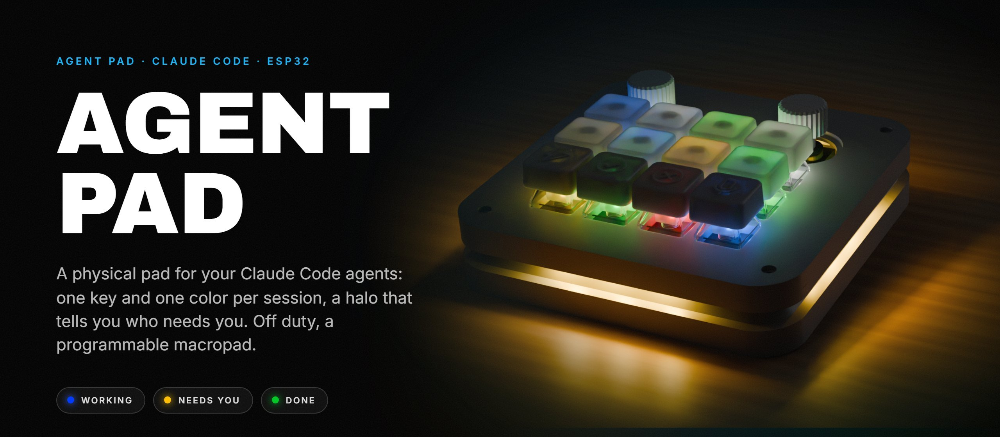
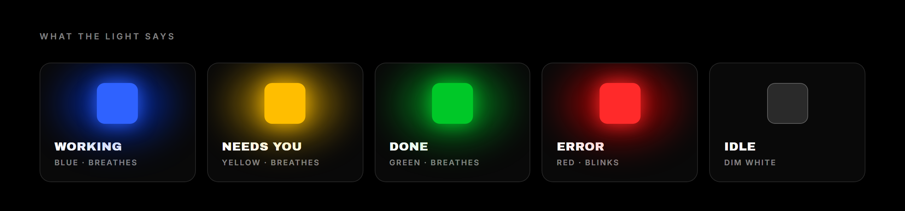
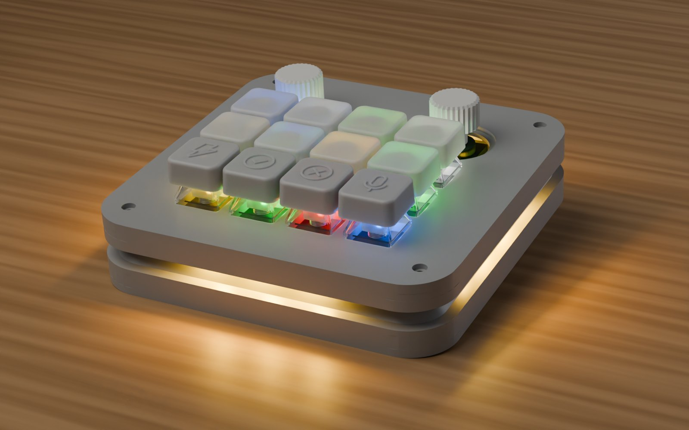
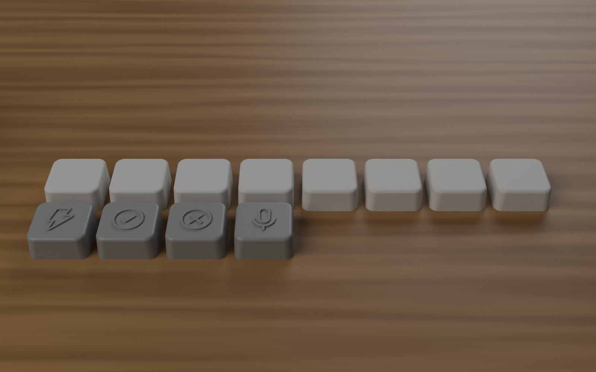
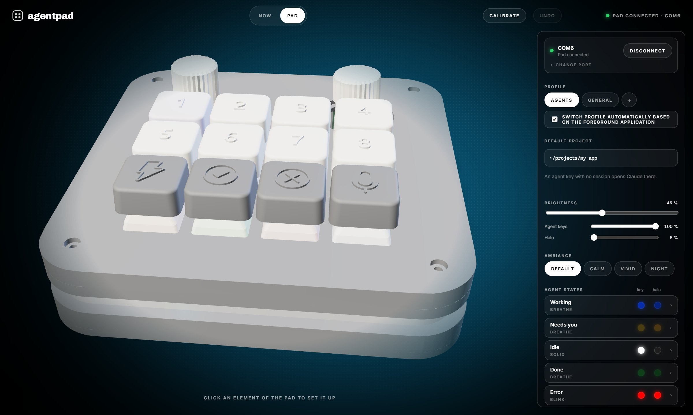
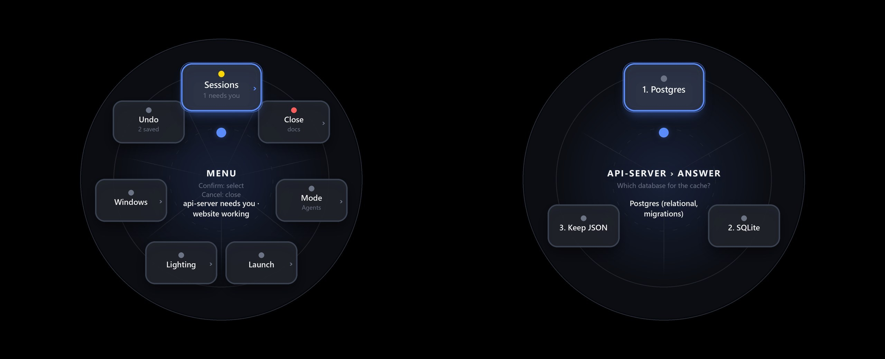
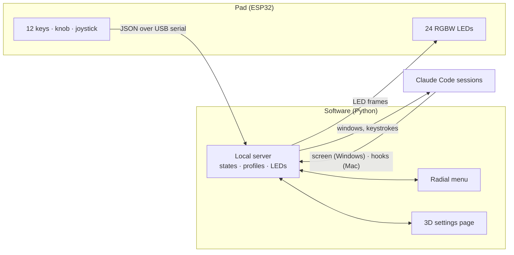
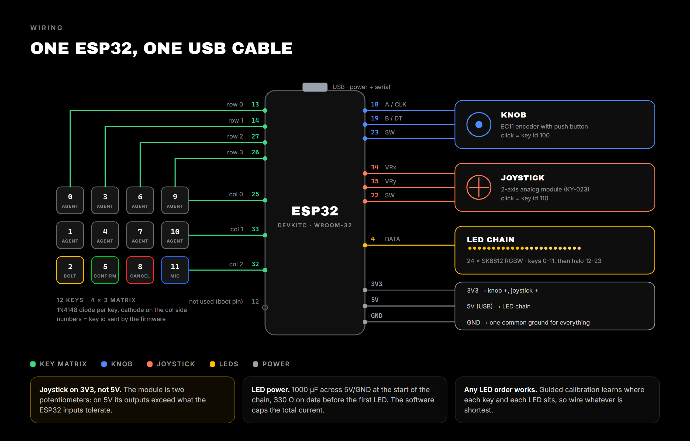

<p align="center">
  
</p>

<p align="center">
  
  
  
  
  
</p>

<p align="center">
  <b>A physical pad for your Claude Code agents. Every session gets its own key and its own color,<br>
  and the halo tells you who needs you. Off duty, it is a fully programmable macropad.</b>
</p>

<br>

## THE IDEA

With several Claude Code sessions running side by side, you spend your time cycling through
windows to find out who needs you. **agentpad** puts every session on one of its 8 top keys: the
key takes the color of what the agent is doing, the halo around the pad sums it all up, and one
press brings the right window to the front. You answer, confirm, dictate and switch sessions without
taking your eyes off the pad.

<br>

<p align="center">
  
</p>

| State | Light | Meaning |
|---|---|---|
| **Working** | blue, breathing | Claude is thinking or writing |
| **Needs you** | yellow, breathing | a question or a permission is waiting for you |
| **Done** | green, breathing | the answer is finished and you haven't looked yet |
| **Error** | red, blinking | something failed |
| **Idle** | dim white | session open, nothing running |

The key of the session in front stays at full brightness while the others dim, so you always
know where you are. Colors, animations and brightness are set per state, separately for the
keys and the halo, with four ready-made ambiances (Default, Calm, Vivid, Night).

## THE PAD

<p align="center">
  
  
</p>

| | |
|---|---|
| **12 keys** | MX switches, each one with its own RGBW LED under a translucent keycap |
| **Knob** | rotary encoder with a push button |
| **Joystick** | analog stick, 8 directions, with a push button |
| **Halo** | 12 LEDs around the case, shining out through a groove between its two lips |

Everything goes through one USB cable to an ESP32. The firmware only reports what you press;
all the behavior lives in the software, so you change what the pad does without reflashing it.

| | What it does |
|---|---|
| **8 agent keys** | one session each: press to show or hide it. An empty key opens a new session in your default project, and that session keeps the key. |
| **Bolt** | switches mode in Claude Code (Shift+Tab: auto-accept, plan) |
| **Confirm** | Enter, or picks the highlighted option of a menu |
| **Cancel** | context-aware: clears your input, "Chat about this" in a menu, otherwise Esc |
| **Mic** | hold to dictate into Claude Code, Confirm to send |
| **Knob** | turn: menu options inside a session, volume elsewhere. Double-click: session grid |
| **Joystick** | up/down: scrolls the session. Click: radial menu |
| **Halo** | the most urgent state across all sessions |

Outside the Agents profile, every key, the knob and the joystick are yours to map: see
[Also a macropad](#also-a-macropad).

<br>

<br>

## ALSO A MACROPAD

When you are not working with agents, the same pad is a regular macropad. Build as many
**profiles** as you need, one per app or per workflow, and let the pad switch to the right one
by itself when that application comes to the front.

| | What you can map |
|---|---|
| **Keys** | key combos and shortcuts, media keys, text to type, or multi-step macros (keys, text, delays, commands) |
| **Knob** | an action for each turning direction: volume, scrolling, zoom, undo / redo... |
| **Joystick** | 8 directions, each with its own action (arrow keys by default) |
| **Lights** | a color per key, a color for the halo, and animations: breathe, wave, pulse, rainbow |

Everything is set in a local web page that shows the pad in 3D: click a key, the knob or the
joystick on the model and choose what it does. Changes are saved as you go, and Ctrl+Z undoes.

<br>

## THE SOFTWARE

<p align="center">
  
</p>

A local page (`127.0.0.1:8420`) shows the pad in 3D, lighting up and pressing down live as you
use it. A **guided calibration** learns how your keys, LEDs and joystick are actually wired,
with no firmware reflash.

### Radial menu

Clicking the joystick opens a small circular menu over your screen: point with the joystick or
the knob, Confirm to pick, Cancel to go back. It reaches the sessions (show, interrupt, close,
answer a question), the profiles and the lighting. While it is open, the halo lights up in the
direction you are pointing.

<p align="center">
  
</p>



<br>

## HARDWARE

| Part | Details |
|---|---|
| Board | ESP32 DevKitC (WROOM-32) |
| Keys | 12 MX switches + 12 1N4148 diodes (4 × 3 matrix) |
| LEDs | 24 SK6812 RGBW: 12 under the keys, 12 in the halo (3 per side) |
| Knob | EC11 rotary encoder with push button, 6 mm D shaft |
| Joystick | 2-axis analog module with push button |
| Case | 3D printed, PETG + translucent PLA, see [`hardware/case`](hardware/case) |

<p align="center"></p>

Full pinout, module pins and the LED map: [`hardware/PINOUT.md`](hardware/PINOUT.md). Parts to print:
[`hardware/case/README.md`](hardware/case/README.md).

<br>

## GET STARTED

```sh
# firmware
cd firmware && pio run -t upload

# software
cd host-bridge && pip install -e . && agentpad-gui
```

Then **Calibrate › Guided calibration** in the page, and **Advanced › Start with the computer** so
it is always there in the background. Details in
[`docs/SETUP.md`](docs/SETUP.md), and for macOS in [`docs/MAC.md`](docs/MAC.md).

<br>

## IN THIS REPO

```
firmware/        ESP32 (PlatformIO): key matrix, encoder, joystick, LEDs, JSON protocol
host-bridge/     software: server, 3D page, radial menu, session tracking, hooks, tests
hardware/        wiring and case v2 (final STL files, keycap generator)
docs/            setup, serial protocol, macOS
```

<br>

## STATUS

Personal prototype, used daily on Windows. macOS support is written but not yet tried on a real
Mac. The halo diffuser is being tested. Tests run without the pad: `cd host-bridge && pytest`.

<br>

<p align="center">
  <sub>APACHE 2.0</sub>
</p>
