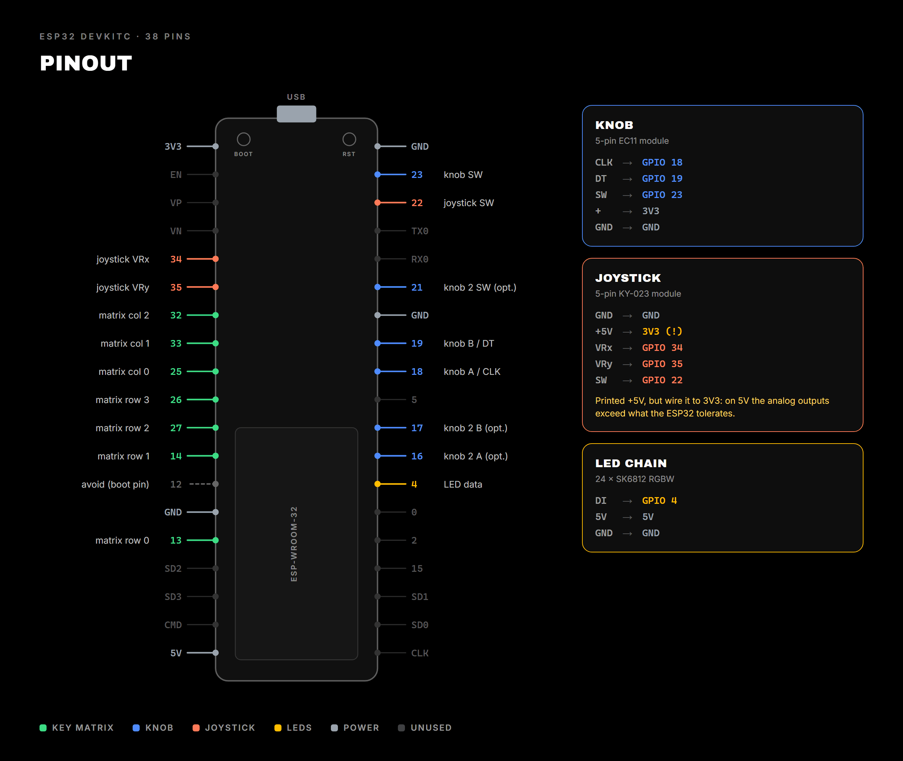
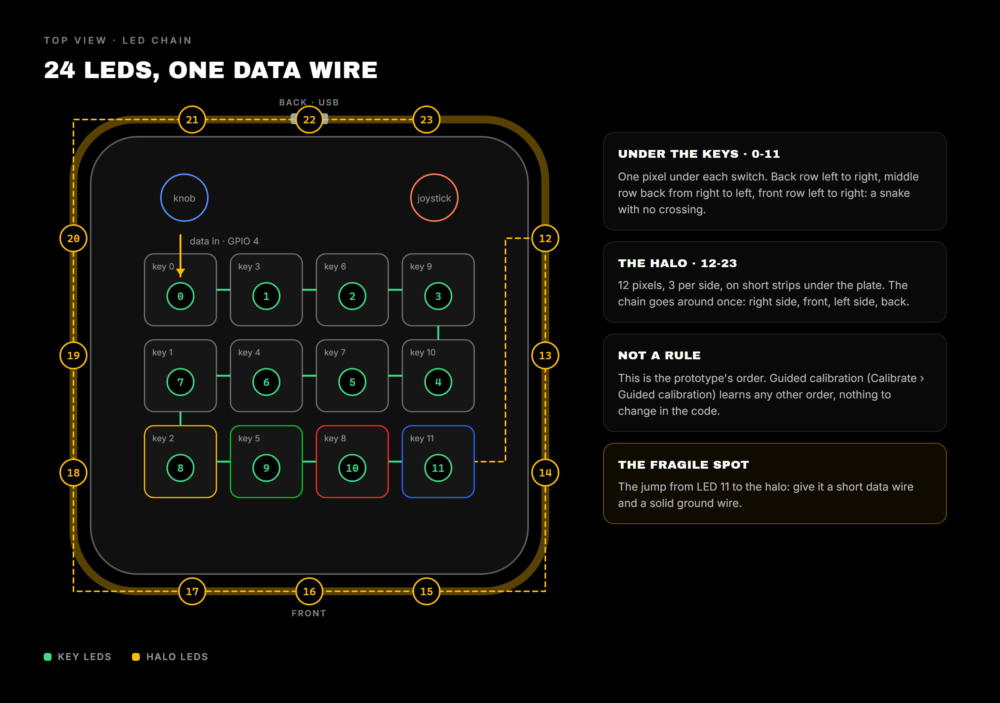

# Wiring (classic ESP32, DevKitC WROOM-32 type)

Default mapping defined in `firmware/include/config.h` — adapt it to your
actual wiring by editing this one file (nothing else to change in the code).

## 4x3 key matrix (12 keys)

A matrix (rather than 12 dedicated GPIOs) saves pins: 4+3 = 7 pins
instead of 12. Each key has a 1N4148 diode in series (cathode on the column side)
to avoid "ghosting" when several keys are pressed at the same time.

| Role     | GPIO |
|----------|------|
| Row 0    | 13   |
| Row 1    | 14   |
| Row 2    | 27   |
| Row 3    | 26   |
| Col 0    | 25   |
| Col 1    | 33   |
| Col 2    | 32   |

Rows are driven as outputs (one at a time LOW, the others HIGH-Z),
cols are inputs with internal pull-up. Key id = `row * 3 + col`
(0-11, top-left to bottom-right if you wire in that order).

GPIO 12 is deliberately avoided (strapping pin, can prevent boot
if pulled to the wrong level at reset).

## Rotary encoder (knob) #0 — required

| Role        | GPIO |
|-------------|------|
| A (CLK)     | 18   |
| B (DT)      | 19   |
| Button (SW) | 23   |

Button reported by the firmware as `key id 100`.

## Rotary encoder #1 — optional (if you have a 2nd knob)

| Role        | GPIO |
|-------------|------|
| A (CLK)     | 16   |
| B (DT)      | 17   |
| Button (SW) | 21   |

Disabled by default (`NUM_ENCODERS 1` in `config.h`) — set it to `2` to
enable it, reported as `key id 101` for its button.

## Planar joystick (5-pin PS2 module)

Standard 2-axis module (KY-023 type): `GND`, `VRx`, `VRy`, `+5V`, `SW`.

| Role        | GPIO |
|-------------|------|
| VRx         | 34   |
| VRy         | 35   |
| SW (button) | 22   |

**WARNING — power this module from 3V3, not +5V.** The module is just
two potentiometers tied to its power pin: if you connect it to
5V, `VRx`/`VRy` can output up to 5V, which exceeds the maximum voltage
tolerated by an ESP32 ADC input (3.3V) and can damage it over
time. Connect the module's pin marked `+5V` to the ESP32's **3V3** pin,
and `GND` to a common ground. GPIO 34/35 are input-only (no
internal pull-up) — not a problem here, the reading is analog
(`analogRead`), no pull-up required.

On the firmware side, raw positions (0-4095) are sent as is;
centering, dead zone and direction detection (8 directions) happen
on the Python bridge side (`host-bridge/agentpad/joystick.py`), not on the ESP32 —
this lets you tune sensitivity without reflashing.

## SK6812RGBW LED strip

| Role      | GPIO |
|-----------|------|
| Data (DI) | 4    |

A single chain of `NUM_LEDS = NUM_KEYS + RING_LEDS` = **24 SK6812 RGBW pixels**:

- **ids 0-11**: one pixel under each key, held by the key LED holder of the v2 case
  (`hardware/case/v2_bloc_plaque/04_matrice_led.stl` and its covers). The 8 agent keys
  are printed in translucent PLA so they take the LED's color.
- **ids 12-23**: the halo, 12 LEDs, 3 per side, on short strips mounted under the plate.
  The light hits a 45° ramp in the case and leaves through the groove between the two
  lips.

- **Order does not matter**: the guided calibration (Calibrate › Guided calibration)
  learns which LED sits where, so you can chain the pixels in whatever order is easiest
  to wire.
- **Power, single USB cable**: one pixel at full white can draw ~60-80 mA, far more
  than a USB port supplies for 24 LEDs. The software applies a **global current budget**
  (`power_budget_ma` in `config.yaml`, 420 mA if unset): if a frame would exceed it, all
  LEDs dim together (same hue, just less bright), see
  `host-bridge/agentpad/led_styles.py::limit_power`. `BRIGHTNESS` in `config.h` stays at
  255.
- A ~1000 µF capacitor between 5V and GND at the start of the chain, and a ~330 Ω
  resistor in series on Data close to the first LED of each strip, are recommended.
  The jump from the key LEDs to the halo is the most sensitive spot: give it a solid
  ground wire.

## Indicative BOM

- 1x ESP32 DevKitC (WROOM-32 or WROVER)
- 12x MX-style mechanical switches
- 12x 1N4148 diodes (anti-ghosting matrix)
- 1x EC11 rotary encoder with push button (knob), D-shaft 6 mm
- 1x 5-pin analog joystick module with push button
- 24x SK6812 RGBW pixels (12 under the keys + 12 for the halo)
- USB-A to USB-micro/C cable depending on the devkit (data + power, a single cable is enough)
- External 5V supply + 1000uF capacitor + 330ohm resistor (optional, only to raise the current budget)
- Hookup wire, perfboard or homemade PCB
